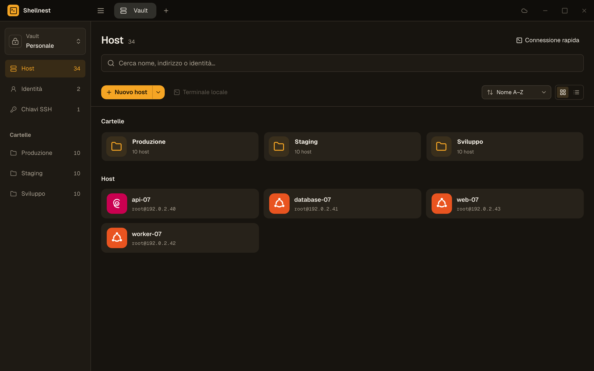
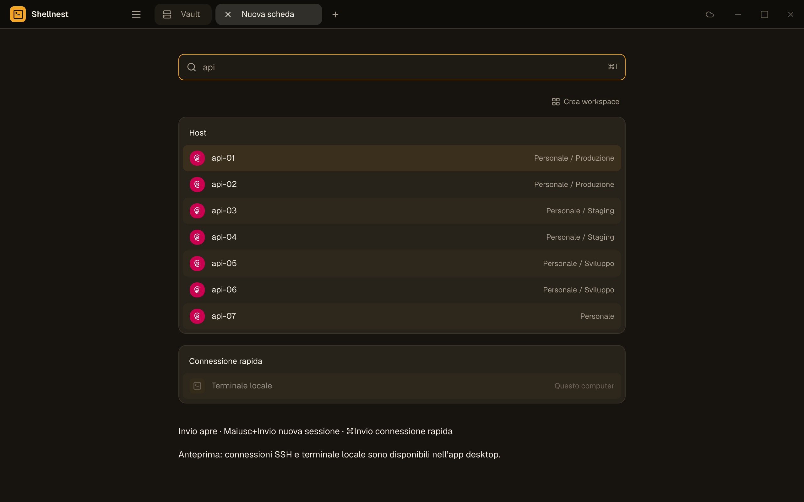
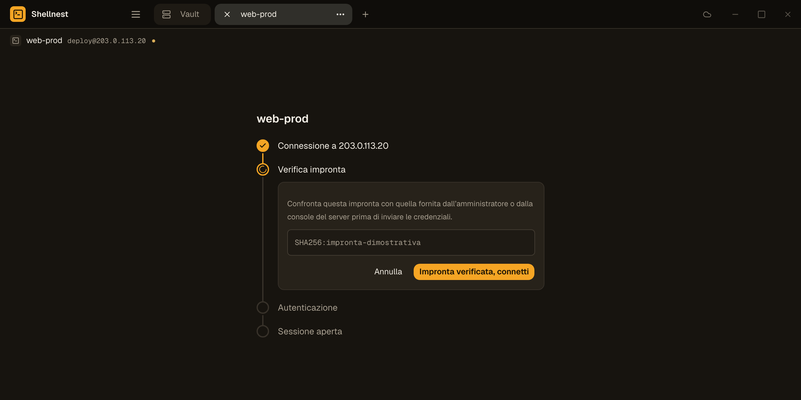

# Shellnest

A desktop SSH client for people who manage their own servers. Hosts, folders, reusable identities and SSH keys live in an encrypted local vault. No account is needed. Optional self-hosted sync keeps several devices in step.

Built with Tauri 2, React and Rust. Windows and macOS.

> **Alpha.** Shellnest is under active development and has not had a security audit. Local use is the tested path. **Sync between devices is experimental.** Back up your vault before trusting it with anything important. The interface is currently in Italian only; translations are welcome.

## Screenshots

The screenshots come from the browser demo (`npm run dev`) with sample data.







## Features

- Encrypted local vault (Argon2id + XChaCha20-Poly1305), several independent vaults, optional unlock key in the system keychain.
- Hosts, nested folders, search, multi-select, quick connect (`Ctrl/Cmd K`).
- Reusable identities and an SSH key store; one identity can serve many hosts.
- Tabbed terminals with split panes, reconnect, duplicate and reorder; local terminal with a native PTY.
- Host key fingerprint check before authenticating, and a hard stop if it changes.
- Terminal themes, fonts and rebindable keyboard shortcuts.
- Optional sync of the encrypted vault through the small Node.js server in [`sync/`](sync) ([deployment guide](sync/README.md)).

Not implemented yet: SFTP, port forwarding, jump hosts, agent forwarding, keyboard-interactive/2FA. See the [roadmap](ROADMAP.md).

## Install

Prebuilt binaries are not published yet. Until then, build from source.

You need Node.js 22.18+, Rust, and the [Tauri 2 prerequisites](https://v2.tauri.app/start/prerequisites/) (Xcode Command Line Tools on macOS; Visual Studio C++ Build Tools and WebView2 on Windows).

```sh
git clone https://github.com/JustFlavio/shellnest.git
cd shellnest
npm ci
npm run desktop        # run in development
npm run desktop:build  # produce an installer
```

Builds are not code-signed, so macOS and Windows will warn on first launch.

## Updates

Shellnest checks GitHub for a newer release a few seconds after launch (turn it off in Settings, Aggiornamenti) and when you choose "Controlla aggiornamenti"; the request contains nothing from your vault. Updates are signed, are downloaded only when you click, and the app restarts only when you click again. How releases work: [docs/releases.md](docs/releases.md).

## Tests

```sh
npm test
cargo test --locked --manifest-path src-tauri/Cargo.toml
```

## Documentation

- [Detailed guide (Italian)](docs/guida.it.md): vaults, sync server setup, limits.
- [Settings](docs/settings.md)
- [Contributing](CONTRIBUTING.md)
- [Security policy](SECURITY.md)
- [Code of conduct](CODE_OF_CONDUCT.md)

## License

[MIT](LICENSE)
